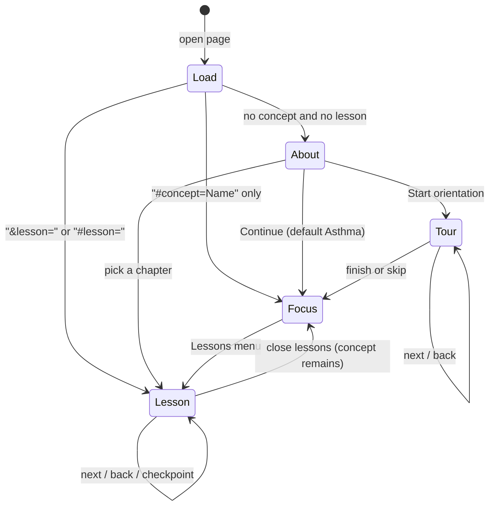

# Design proposal: interactive GALEN/GRAIL tutorial and orientation

This is a **design proposal only**. This pull request adds no tutorial UI and does not change the running browser. Implementation would follow a later, agreed phase.

The proposal is based on Alan Rector's draft *PEN&PAD, GALEN & GRAIL: Thoughts on lessons learned — DRAFT — Nov 2026*, published at [https://pen-pad-revival.github.io/assets/PEN-PAD-GALEN-GRAIL.pdf](https://pen-pad-revival.github.io/assets/PEN-PAD-GALEN-GRAIL.pdf) (footer date 17/11/2026 08:20). **The paper is a draft; comments are invited in the text itself.** Facts taken from it are isolated in §2 and §12, with page numbers. Everything else is a design suggestion. Short quotations only; the PDF is not copied here and should not be vendored into this repository without a separate go-ahead.

Wireframes below are **illustrative sketches**, not specifications of layout, type, or colour.

---

## 1. Goals and audiences

**Goal.** Help a first-time visitor use the OpenGALEN 8 browser *and* understand a handful of GALEN/GRAIL ideas that the draft argues still matter, by walking the real classified hierarchy rather than a slide deck.

**Non-goals (for this design).** No live classifier or DL reasoner in the static page (the browser already shows the 2010 classified hierarchy). No editing of OpenGALEN. No Clinergy extracts in this repository. No attempt to finish or rewrite Alan's draft.

**Audiences** (a lesson can declare one or more; the orientation tour is for all):

| Audience | What they should leave able to do |
|---|---|
| Newcomer | Search, read the graph and side panel, follow a `#concept=Name` link, and say what a definition, a sanction, and an is-a parent are. |
| Clinician | See how a familiar idea (thumb, pericarditis, asthma) is *composed*, and where a patient statement would leave the terminology and enter a record. |
| Informatician | Map the draft's layers, sanctions, post-coordination, and “pathological status” workaround onto what this dump actually contains. |
| Clinergy mapper | Use landmark concepts (Thumb = Pollux, PlexusBrachialis = BrachialPlexus, Hand/Finger) as a orientation to OpenGALEN names, without loading Clinergy content here. |

---

## 2. Facts from the draft paper

The paper “is an attempt to distil some of the technical lessons from PEN&PAD, GALEN and GRAIL,” work that “began in the late 1980s and continued through the 1990s” (p. 1). A footnote records that “the first efficient DL classifier, FACT, was developed by Ian Horrocks in response to some of GRAIL’s perceived limitations” (p. 1, n. 1).

### 2.1 Principle 1 — “What’s it for?” (p. 1)

The stated goal of PEN&PAD and GALEN was “Useful and Usable systems for health care professionals.” Terminology and concept modelling were “a means to that end.” The PEN&PAD user interface was developed through a user-centred design process that the draft says “is arguably more important than the knowledge representation and software lessons,” and is “best described in the accompanying videos and their references.”

Principles that emerged include: sound, computable, and human-comprehensible presentation; an explicit purpose and scope (different coding systems serve different purposes); that “the medical record consists of statements about what carers have heard, seen, thought and done”; that “GRAIL should enable all and only what is sensible to say”; clean separation of meaning, knowledge and data layers; modularity (core modules plus extensions); interworking with other terminologies “with no expectation of one-to-one mappings”; “hooks to UIs and EHR templates/schemas”; and automatic quality assurance packaged with the classifier or other compilation of models.

### 2.2 Principle 2 — clean separation of layers (pp. 1–3)

The draft calls the distinction between ontological and background knowledge “the principle most commonly misunderstood.”

- **Meaning layer** (p. 1, §2.1.1): ontological/logical statements that are universally true within the application’s scope and can be reasoned over by a DL reasoner. Three kinds are listed: (a) definitions, exemplified as “Pericarditis = Inflammation of the Pericardium”; (b) universals, exemplified as “(All) Hands are parts of upper extremities” and “(All) Birds are Vertebrates”; (c) static-within-scope facts, exemplified as “Paris is the capital of France.” A “?Normative?” item, “The heart is located in the left chest,” is deferred to the addendum.
- **Background knowledge** (p. 2, §2.1.2): statements that “may be/are generally/… true but are not necessarily true,” with semantics other than DL. The temptation is “to include too much.” The “classic manifestation” of the confusion is the question “How do I say ‘may’ on OWL?” Examples: non-universal reciprocals of universals (“(All) Finger partOf some Hand” vs “(Most) Hand hasPart some Finger”); useful generalisations (“(Most) Gram positive bacteria sensitiveTo (Most) Penicillin”); explicitly uncertain statements; and contranormative flags such as “right sided heart (dextrocardia).” “GALEN represented generic background knowledge as ‘extrinsics’ which were ignored by the classifier but available to applications and inherited by default.”
- **Higher-order knowledge** (p. 2, §2.2) was “excluded except in comments.” Example: “Gorilla is an endangered species” is about the class/species, not about all gorillas, and “cannot be reasoned over by a DL reasoner.”
- **Editorial** (authorship, change history, status) and **linguistic** (multilingual labels, non-semantic IDs) layers are listed (p. 2, §2.3–2.4).
- **Interworking** (pp. 2–3, §2.5): mappings, “in particular ICD,” should not be assumed one-to-one. Detailed experiments with SNOMED and WHO are cited (Rodrigues et al., 2014, n. 3).
- **Data layer** (p. 3, §2.6): “Excluded from PEN&PAD and GALEN themselves.” “The GALEN model was about meaning and knowledge, not data.” Statements about individual patients “do not follow DL semantics because they can never be ‘necessary’.” For data, “negation can only be correctly dealt with under negation as failure or other contingent mechanisms,” usually a query language.

### 2.3 Principle 3 — automatic QA (p. 3)

Once a classifier is in the authoring loop, “the reason for errors ceases to be obvious.” A discovered error may be an inference from a source error, and will reappear if the source is not corrected (Rector, Brandt and Schneider, 2011, n. 4). “A distinctive part of GALEN” was a set of queries run as the final step of each classification cycle, stating what should and should not be true; further queries were added when errors were found. The draft notes that better “justifications” for DL inferences have been developed since (Horridge, 2011, n. 5), but that a checking step “is at least prudent.”

### 2.4 Understanding GRAIL: sanctions and extrinsics (pp. 3–4)

“(Note: sanctions were not included in the OpenGrail models as they were considered obsolete for the terminology)” (p. 3). The original goal of GRAIL was to specify “all and only what it was sensible to say.” Sanctions were “GRAIL’s method of specifying and constraining” that, at two levels: **grammatical** (high-level usage; a sensible statement had to specialise a grammatical one) and **sensible**. “No concept could be defined by an expression unless that expression was a specialisation of a sensible sanction.” A third keyword, **necessarily**, is used in the examples and later described (p. 5, §7) as an attempt to mark the logical/ontological commitment as distinct from sanctions and extrinsics. Combined keywords existed, e.g. “GrammaticallyAnd Sensibly” (p. 4).

The draft’s OWL-like examples (pp. 3–4):

- Grammatically: `BodyPart is_part_of some BodyPart`; sensibly: `Finger is_part_of some Hand`; necessarily: `Thumb is_part_of some Hand`.
- Grammatically: `Injury hasLocation some BodyPart`; sensibly: `Dislocation hasLocation some Digit`.
- Grammatically: `BodyPart hasLaterality some Laterality`; sensibly: `Digit hasLaterality some Laterality`.
- Expression: `(Dislocation that hasLocation some (Thumb that hasLaterality some RightLaterality)`.

Extrinsics (p. 4, §4.2) “were hung on the ontology” for other forms of knowledge and sometimes UI information, inherited by default, and “intended to be used for links to specific decision support or other functions, although this was never implemented.”

### 2.5 GALEN and EHRs (pp. 4–5)

To apply a code to a patient situation is “to say that that situation is a member of the corresponding class.” Producing a class for every possible situation is impossible, and patient statements belong in the data layer, so they “cannot not be represented directly in the description logic.” GALEN’s solution was to generate a new post-coordinated class expression at run time, classify it with a DL query, and if satisfiable enter it in the record as the expression, as an index into a repository of such expressions, or both — without making the new class a permanent part of the model, “because the model would rapidly have become too large to manage.” The interface could use the hierarchy to inherit “any other sensible sanctions or extrinsics” and offer further specialisation.

On encapsulation (pp. 4–5, §5.2): during the project “the ontology was confined almost entirely to a core of pathophysiology.” The draft’s starting point is that record statements are “Documentation of Statements of Observations of Patient Situations.” “To a first approximation, Documentation … and Statement … belong in the EHR and Observation and Patient Situation in the terminology.” Usability can conflict with that neat chain, “such as having single codes for commonly occurring complexes that span more than one level.”

### 2.6 Inheritance of most specific defaults (p. 5)

The “fundamental mechanism used throughout PEN&PAD both for assembling interface fragments and for managing which extrinsics applied to which classes” was inheritance of all most-specific default values for a role: a value on an ancestor applies unless an intermediate class overrides it. Multiple most-specific values are “vanishingly rare” if the ontology is normalised, but software “must always collect a set.” The same mechanism is described as “a key part of the mechanism used to translate between SNOMED and ICD.” Searching bottom-up “converges rapidly … because hierarchies converge upwards.” The draft points to “Ontology indexed resources slide 5:45 in Interview 3” and to Nowlan & Rector 1991 and Rector 2003/04 (n. 6).

### 2.7 Other reflections (pp. 5–6)

GRAIL and GALEN “were conceived before DL semantics were well specified … and long before OWL-DL let alone OWL-EL.” Comments were free text in authoring files, “not part of the classified model” (p. 5, §7.1). GRAIL “did not include true individuals”; inverses “behave differently for individuals and classes” — `A isPartOf some B` does **not** imply `B hasPart some A` (pp. 5–6, §7.2). Neither OWL-EL nor GRAIL supported disjunction, which made SNOMED-style “Disorder” (fault in a structure or in a process) awkward; GALEN’s workaround was to flag disorders with `pathological_status`, roughly `Disorder = Entity that has_status some Pathological_status` (p. 6, §7.3). GRAIL did not support disjoints, but required a “normalised hierarchy”: “no primitive could have more than one primitive parent” (p. 6, §7.4). The draft advises avoiding the phrase “kind of”; the GRAIL equivalent of OWL `subClassOf` is `newSub`, written “backwards from OWL, A newSub B.” `newSub` also “was [a] convenient check on spelling errors” (p. 6, §7.5 and n. 7).

### 2.8 Addendum: partonomies and normative knowledge (pp. 6–7)

“Like most terminologies, GALEN represented normal anatomy.” Functional and structural part-hood “need to be distinguished although they usually coincide.” The draft writes `isPartOf` as a super-property of `isStructuralPartOf` and `isFunctionalPartOf`, and uses `hasLocus` as a generic locative. Putting normativity into DL “adds complications”; the draft’s own examples use `Hand`, `Finger`, `UpperExtremity`, `Heart`, `CirculatorySystem`, `SideOfChest`, `LeftLaterality`, `Normative`, and `Contranormative`. It asks whether a terminology, as opposed to a general knowledge base, needs to go there, and notes that a strict DL treatment “is tedious and obfuscating unless dealt with cleverly by user tools.”

---

## 3. What the browser already provides

The running app is a static, client-side graph browser of OpenGALEN 8 (2010-01-28 classified dump, 125,511 concepts). Nothing is reasoned in the page. Layout, as of `origin/main` (including the incoming-relationships and red told-parent work from PR #11):

- **Top bar:** title, type-ahead search (CamelCase names and published labels), switches for Generated classes, Labels, Clustering, and Cluster-marking.
- **Centre stage:** a Sugiyama DAG of the focus concept’s neighbourhood (ancestors, optional collapsed `+n` clusters, children, optional siblings). Zoom/pan/fit controls. A bottom-left **told-parent banner** appears when the focus has a restored told OWL `SubClassOf` parent that the classified dump omitted (red is-a links; see [issue #10](https://github.com/erik-sundvalls-bots/opengalen-browser/issues/10)).
- **Right side panel:** heading (including `Thumb = Pollux` style equivalence), GRAIL-like definition, sanction level, sensible / grammatical role sanctions, `topicNecessarily` lines, dissection rubric, parents, children, **incoming relationships** (nothing ticked by default; filter; cap of 300 rows), and a “GRAIL source” snippet when one was extracted. Toggles: Children, Siblings, Ancestors only, Relationships (dashed, coloured by property group), Sanctions and qualifiers (dotted, one colour). The panel collapses to a narrow icon rail.
- **Deep links:** `#concept=Name` (a `?concept=Name` query is accepted and rewritten to that hash). A visit *without* a concept opens the About/licence dialog; a concept permalink skips it. Default focus, on a plain visit after About, is `Asthma`.
- **Data loading:** graph and search index up front; definition, relationship and incoming shards lazy-loaded (`d/`, `r/`, `i/`, 512 concepts per shard). Repeat visits are cached in IndexedDB.

These are the hooks a tutorial should use, not replace.

---

## 4. PDF examples versus names that exist in this dump

Lesson steps must open **real** `#concept=` addresses. The draft often uses OWL-like pseudo-syntax and pedagogical names. The following were checked against `site/data/graph.bin.gz` and the definition/property shards (2026-11-18 build).

**Present and usable as lesson landmarks**

| Name in the dump | Why it is useful |
|---|---|
| `Pericarditis` | Definition: `InflammationLesion which hasSpecificLocation Pericardium`. Closest real form of the draft’s “Pericarditis = Inflammation of the Pericardium” (p. 1). |
| `InflammationLesion` / `InflammatoryProcess` | `InflammationLesion` = `PathologicalBodyStructure which hasUniqueAssociatedProcess InflammationProcess`. Two-step composition with Pericarditis. |
| `Pericardium`, `Heart`, `CardiovascularSystem` | Heart has `sensibly isFunctionalComponentOf CardiovascularSystem` (and `sensiblyAndTopicNecessarily` the same). The draft’s `CirculatorySystem` and `isFunctionalPartOf` are **not** dump names; these are the real analogues. |
| `Thumb` = `Pollux` | Definition: `Finger which hasOrdinalPosition first`. Parents and children hang on the merged node (Finger, `SupernumeraryThumb`). Incoming example on `first` already documented in the README. |
| `Finger`, `Digit`, `Hand`, `UpperExtremity` = `UpperLimb` | Digit lists sensible `hasOrdinalPosition first`…`fifth`. Hand lists `sensibly hasStructuralComponent Finger` (real analogue of the draft’s part-of / hasPart pair). `UpperExtremity` = `Extremity which hasUpperLowerSelector upperSelection`. |
| `leftSelection`, `rightSelection`, `LeftRightSelector` | Real laterality *values*. Property is `hasLeftRightSelector`, not `hasLaterality`. Example definitions: `KidneywhichhasLeftRightSelectorleftSelection`, `DoubleOutletLeftVentricle`, `ChestPainRadiatingToLeftArm` (nested `Arm which hasLeftRightSelector leftSelection`). |
| `pathological`, `physiological`, `hasPathologicalStatus` | Real analogue of the draft’s `pathological_status` workaround (p. 6). `Asthma` has an inferred parent `ProcesswhichinvolvesOrganicSolidStructurehasPathologicalStatuspathological`. |
| `PlexusBrachialis` = `BrachialPlexus` | Stable bilingual/Latin landmark for a Clinergy mapper. |
| `Bird`, `Vertebrate`, `Gorilla` | The draft’s pedagogical universals / higher-order example (pp. 1–2) exist as biological classes. `Bird` has parent `Vertebrate`. |
| `GramPositiveBacterium`, `Penicillin` | Both exist. The draft’s “sensitiveTo” generalisation (p. 2) is background knowledge; it should **not** be presented as a definition in this dump (no `sensitiveTo` property; `hasSensitivity` exists as a property name but is not used here as a teaching axiom). |
| `JointDislocation`, `Injury`, `FingerPain`, `first`, `OrdinalPositionValueType` | Related compositional and value-type examples. |
| `newSub` in GRAIL source snippets | Visible in extracted GRAIL text (e.g. around named extremities and digits), matching p. 6. |

**Draft names that are *not* concepts or properties in this dump**

`RightLaterality`, `LeftLaterality`, `Laterality`, `hasLaterality`, `CirculatorySystem`, `SideOfChest`, `isPartOf`, `hasPart`, `isStructuralPartOf`, `isFunctionalPartOf`, `hasLocus`, `hasNormality`, `Normative`, `Contranormative`, `NormalVariant`, `Dextrocardia`, `Paris`, `France`, `Disorder` (only as a suffix in many names, not a root class of that word), `Entity`, `Pathological_status` (underscore form).

**Design rule.** When a lesson discusses a draft example whose name is absent, show the draft wording in the lesson panel as a quotation, then walk the *nearest verified* dump concept, and say so in one line. Do not invent or alias missing names in the graph.

A second tension to teach honestly: the draft says sanctions “were not included in the OpenGrail models as they were considered obsolete for the terminology” (p. 3), yet this OpenGALEN 8 browser *does* show sensible and grammatical sanctions and `topicNecessarily` lines taken from the published sources. Whether “OpenGrail” and “OpenGALEN 8” are the same artefact is an open question for Alan (§11).

---

## 5. Proposed experience

### 5.1 Two complementary modes

1. **Orientation tour** (about five short steps, skippable). A first visit, or a “How to read this browser” control next to About, walks search, the graph (clusters, zoom, click-to-focus), the side panel and its toggles, incoming relationships, red told-parent links, and permalinks. This is product literacy, not GRAIL theory. It can start on `#concept=Asthma` (the current default) or `#concept=Thumb`.
2. **Lesson mode.** A docked **lesson panel** (left on a wide window; a bottom sheet on a narrow one) runs a chapter of steps. Each step opens a concept (updating `#concept=`), may turn a toggle on, highlight a panel section or a graph node, and asks the reader to do one thing (tick a sanction, expand a cluster, follow a parent, open incoming on `first`, …). The existing concept panel and graph stay authoritative; the lesson talks *about* them.

A “Lessons” entry in the About dialog and a small book/compass control on the side rail start either mode. Lessons remain available from a table of contents after the tour.

### 5.2 UI elements

- **Tour overlay.** Dim the stage, cut a hole around one control, and show a short caption with Next / Back / Skip. Do not block search or the concept panel from being used when a step asks the reader to try them.
- **Lesson panel.** Title, one-paragraph teaching point, “Do this” task, optional “In Alan’s draft…” quotation with a page citation and a link to the PDF, optional “In this dump…” correction when names differ, Back / Next, and a compact chapter list with progress ticks.
- **“Explain this”.** An opt-in pointer: hover or tap a node, a sanction row, a red is-a link, or a GRAIL keyword (`which`, `sensibly`, `topicNecessarily`, `newSub`, `name`) to get a two-line explanation. Reuse the existing hover preview (`#tip`) rather than a second popup system if possible.
- **GRAIL syntax view.** Already in the side panel. Lesson steps should *scroll it into view and highlight a span* (for example `Finger which hasOrdinalPosition first`) rather than invent a parallel editor. A later phase may add a read-only “compose an expression” box that only accepts specialisations already present as named concepts (no classifier).
- **Checkpoints.** Two or three per chapter, not a score culture: e.g. “Which of these is a definition, and which is a sanction?” with answers that reveal the panel section. Store completion in `localStorage`; do not send anything anywhere.
- **Progress.** A thin chapter list; resume from the last step on the same browser. A “Reset tutorial progress” link in About.

### 5.3 Deep links

Keep today’s `#concept=Name` working unchanged. Extend the hash with optional, ignored-if-unknown fields:

```text
#concept=Hand&lesson=sanctions&step=2
```

If `lesson` is present, open lesson mode at that step after the model has loaded, and still skip the automatic About dialog (as concept permalinks already do). A bare `#lesson=orientation` starts the tour. Implementation must not break existing `#concept=Thumb` links from the README, issues, or the revival site.

---

## 6. Suggested chapters (mapped to the draft)

Each chapter is a small YAML (or Markdown-frontmatter) file under `site/lessons/`. Titles below are working titles. Tasks use only verified names.

**0. Orientation (browser tour).** Search `Thumb`, see `Thumb = Pollux`, open children, try Clustering, copy the permalink. Optional: open `#concept=first` and notice the red told parent `OrdinalPositionValueType` and the incoming list (`Thumb hasOrdinalPosition first`). *Draft hook:* Principle 1, “human comprehensible” (p. 1).

**1. What’s it for?** One screen of purpose (usable systems for health care professionals; terminology as a means). Point at the Interview videos on the revival site rather than retelling the UCD process. *Source:* p. 1.

**2. Three layers: meaning, background, data.** Open `Pericarditis` and read the definition (meaning). Open `Bird` and note the universal “Bird is a Vertebrate” as a parent, contrasting it with the draft’s Paris example, which is *not* in this terminology. Open `Gorilla` and explain that “endangered species” would be a higher-order comment, not a DL axiom. Close by saying patient data is out of scope for this graph (p. 3, §2.6). *Source:* pp. 1–3.

**3. Sanctions: grammatical, sensible, necessary.** Open `Hand`, turn on **Sanctions and qualifiers**, find `sensibly hasStructuralComponent Finger`, then the `sensiblyAndTopicNecessarily` and `topicNecessarily` lines. Open `Digit` and its ordinal-position sanctions. Open `Thumb` and show that the *definition* `Finger which hasOrdinalPosition first` specialises those sanctions. State the name mapping: the draft’s `is_part_of` / `hasPart` are `hasStructuralComponent` / `isStructuralComponentOf` here; `topicNecessarily` is the dump’s closest peer to the draft’s “necessarily.” *Source:* pp. 3–4, §4.1.

**4. Compositional concepts (and post-coordination).** Walk `InflammationLesion` → `Pericarditis`, then `Finger` → `Thumb`, then `ChestPainRadiatingToLeftArm` as a nested laterality expression. Quote the draft’s “dislocation of a right thumb” expression (p. 4) and say plainly that no concept of that wording, and no `RightLaterality`, exists in this dump — `JointDislocation` and `hasLeftRightSelector` / `leftSelection` are the available pieces. Explain GALEN’s *dynamic* post-coordination (temporary classified classes for a patient situation, p. 4) and that this static browser can only show *already named* compositions. *Source:* pp. 4–5, §5.1.

**5. Where the terminology ends and the record begins.** A short encapsulation chapter for clinicians and Clinergy mappers: Observation / patient situation can live in the concept model; “who documented this, when, and about which encounter” cannot. Use `FingerPain` (a named clinical phenomenon) as the focus, and say duration, certainty, and “this patient” belong in an information model (openEHR or FHIR), not as a line-break inside a code. *Source:* pp. 4–5, §5.2, plus Principle 1’s record sentence on p. 1.

**6. Inverses, reciprocals, and partonomies.** On `Hand` and `Pericardium` / `Heart`, contrast a universal in one direction with a *sensible* reciprocal in the other (draft p. 2 example (a) and §7.2). Show Heart’s `isFunctionalComponentOf CardiovascularSystem` versus structural component sanctions, matching the draft’s functional/structural distinction (pp. 6–7) under the real property names. *Source:* pp. 2, 5–7.

**7. “Disorder” without disjunction.** From `Asthma` or `pathological`, show `hasPathologicalStatus` and the draft’s workaround for a missing disjunction (p. 6, §7.3). Keep this short.

**8. Names, `newSub`, and not saying “kind of.”** `Thumb = Pollux`, `UpperExtremity = UpperLimb`, `PlexusBrachialis = BrachialPlexus`; GRAIL source lines that use `newSub` and `name`. *Source:* p. 6, §7.5.

**9. (Later) Automatic QA and gaps in the classified dump.** A specialist chapter: the draft’s classification-time queries (p. 3) as *context* for why a checking step matters, then a careful look at a red told-parent edge and issue #10. This must not claim the browser can re-run a classifier. A future “classifier with MCP” is out of scope here and should stay a separate issue if pursued.

Chapters 0–4 plus the lesson-panel shell are the proposed MVP. 5–8 follow. 9 is optional and later.

---

## 7. Wireframes (illustrative sketches)

These are not visual design. They show structure and attention, not typography or colour.

**Sketch A — About dialog with a way into the tour**

```text
+------------------------------------------------------------------+
| About and licence                                                |
| ... existing acknowledgement, counts, controls help ...          |
|                                                                  |
|  [ Continue ]     [ Start a 5-step orientation ]                 |
|  Lessons:  What's it for?  ·  Sanctions  ·  Composition  ·  …    |
+------------------------------------------------------------------+
```

**Sketch B — Orientation tour overlay**

```text
+-- top bar -------------------------------------------------------+
| OpenGALEN 8   [ Search concepts          ]  Generated Labels ... |
|                  ^^^^^^^^^^^^^^^^^^^^^^^^                        |
+------------------.  cut-out around search  .---------------------+
|  graph (dimmed)  |                         |  side panel (dimmed)|
|                  |  +-------------------+  |                     |
|                  |  | 1/5  Search        |  |                     |
|                  |  | Type “thumb”. Pick |  |                     |
|                  |  | Thumb. The graph   |  |                     |
|                  |  | will refocus.      |  |                     |
|                  |  | [Back] [Next] [Skip]| |                     |
|                  |  +-------------------+  |                     |
+------------------------------------------------------------------+
```

**Sketch C — Lesson mode (wide window)**

```text
+-- top bar -------------------------------------------[ Lessons v]+
|                                                                  |
| +-- lesson (left) --+ +-- graph --------------+ +-- concept ----+|
| | 3. Sanctions      | |                       | | Thumb = Pollux ||
| | Step 3 of 5       | |    Finger             | | Definition     ||
| |                   | |      |                | |  Finger which  ||
| | In this dump,     | |    Thumb              | |  hasOrdinalPos.||
| | Hand lists        | |      |                | |  first         ||
| | “sensibly has     | |  SupernumeraryThumb   | |                ||
| | StructuralComp-   | |                       | | Sanctions  [on]||
| | onent Finger”.    | |                       | | Incoming       ||
| |                   | |                       | | GRAIL source   ||
| | Do this: open     | |                       | |   (span highlighted)
| | Hand and tick     | +-----------------------+ +----------------+|
| | that sanction.    |                                            |
| |                   |  In Alan's draft (p. 3): “Thumb is_part_of |
| | [Back] [Next]     |  some Hand” — wording differs; see left.   |
| +-------------------+                                            |
+------------------------------------------------------------------+
```

**Sketch D — “Explain this” on a GRAIL keyword / red edge**

```text
  ... GRAIL source ...............................................
  Digit sensibly hasOrdinalPosition [first second third ...];
        ~~~~~~~~
        +----------------------------------------------+
        | “sensibly” marks a sanction: it is allowed   |
        | to say this, not that it is always true.     |
        | Draft §4.1, pp. 3–4.                         |
        +----------------------------------------------+

  first  ---red is-a--->  OrdinalPositionValueType
            ~~~~~~~~~
            Tooltip: told OWL parent restored from the
            source, omitted by the classified dump.
            See issue #10. Not a live classifier result.
```

**Sketch E — Checkpoint**

```text
+------------------------------------------------------+
| Checkpoint  ·  Chapter 3                             |
| The line “Finger which hasOrdinalPosition first” on  |
| Thumb is:                                            |
|   ( ) a sensible sanction                            |
|   ( ) a definition (equivalent-class expression)     |
|   ( ) a patient-record statement                     |
| [Check]   After answering, the definition section    |
|           in the right panel is highlighted.         |
+------------------------------------------------------+
```

**Sketch F — Narrow window (lesson as a bottom sheet)**

```text
+-- top bar / search ----------------------------------+
| graph (shorter)                                      |
| side panel collapsed to the icon rail, or a tab      |
+-- lesson sheet --------------------------------------+
| 4. Composition  ·  Step 2 of 6              [ ^ ]    |
| Open Pericarditis. Read the definition, then follow  |
| hasSpecificLocation to Pericardium.                  |
| [Back]  [Next]                                       |
+------------------------------------------------------+
```

---

## 8. Tutorial state flow

Illustrative only; names of states can change in implementation.



Deep links are restored after `Load`. Progress ticks are read from `localStorage` and do not change the URL except for the current `lesson` and `step`.

---

## 9. Implementation notes

- **Stay static.** No backend, no terminology-server calls, no classifier. Lesson files are static JSON or YAML (YAML compiled to JSON at build time if that is easier than parsing YAML in the browser) plus short Markdown strings, fetched on demand when the reader opens Lessons — not on first paint — so the current lazy-loading budget is preserved.
- **Content location.** Proposed: `site/lessons/index.json` (id, title, audience tags, step count) and `site/lessons/{id}.json`. MIT, like the other browser code. Citations point at the PDF URL and page numbers; do not paste long excerpts.
- **Drive the existing app.** A small `tutorial.js` should call the same `go(name)` path that search uses, toggle the same `data-act` buttons, and add CSS highlight classes to known panel section ids. Avoid a second graph renderer.
- **Hash parser.** Today `hashName()` only accepts `^#concept=(.*)$`. It will need to accept extra `&key=value` pairs and ignore unknown keys, so older clients still get the concept.
- **Highlight targets** should be stable ids in the panel (definition block, sanctions list, GRAIL source, incoming list, told banner). Some of those will need ids added when the MVP is built.
- **Generated names.** Lessons should prefer short official names (`Thumb`, `Pericarditis`). When a step must open a `which`-style name (`KidneywhichhasLeftRightSelectorleftSelection`), turn Generated on and explain the name in the lesson panel.
- **i18n.** Not in the MVP. The draft’s linguistic layer (p. 2, §2.4) is a later hook if labels already in the dump are used.
- **Licence reminder.** Tutorial prose must keep the GOSL acknowledgement for any displayed OpenGALEN content, as the app already does.

---

## 10. Phased plan

**Phase 0 — this document.** Review with Erik (and, if Erik wishes, Alan). Agree the chapter set, the hash shape, and the name-mapping rule in §4. No UI work.

**Phase 1 — MVP.** Lesson-panel shell, hash extension, orientation tour (chapter 0), and chapters 2–4 (layers, sanctions, composition). YAML/JSON lesson files for those chapters only. “Explain this” limited to a few keywords (`sensibly`, `topicNecessarily`, `which`, `newSub`) and the red told-parent banner. Progress in `localStorage`. Manual walkthrough plus a small test that every `concept:` in the lesson files exists in `graph.bin.gz`.

Chapters 0 and 2 were written before Alan’s November 2026 reply. Chapters 3 and 4, and chapter 5 with the chain in §5.2 as the main text, were written after that reply. Question 6 is still open: chapter 5 carries a marked aside Erik can keep or drop.

**Phase 2.** Chapters 1, 5–8, checkpoints, a Lessons index in About and the rail, resume-from-last-step, and highlight support for incoming relationships (the `first` / Thumb example).

**Phase 3 (optional).** Read-only “try this expression” box constrained to named concepts already in the dump; richer “Explain this” on property groups; a Clinergy-mapper landing page that only lists OpenGALEN landmarks and deep links (still no Clinergy content in the repo).

**Phase 4 (separate, not promised).** Chapter 9 as documentation of QA practice and issue #10. A classifier, or a classifier MCP for mapping work, would be a different project: this site has no reasoner and should not pretend to grow one.

---

## 11. Open questions for Erik and Alan

Answers from Erik, 18 Nov 2026, are given under each question.

1. Is the November 2026 PDF the text lessons should cite, given that it is still a draft? Should lesson quotations wait for a later revision?
   - **Answer (Erik):** Cite and quote the draft now; no need to wait.
2. The draft says sanctions were omitted from “the OpenGrail models” (p. 3). This browser still shows them for OpenGALEN 8. Which statement should the tutorial lead with?
   - **Answer (Alan, November 2026, personal communication to Erik):** He is fine with the lessons proceeding. On sanctions he wrote that he should have said they were omitted “in the owl version except as comments ( not guaranteed to be complete)”. The lesson therefore teaches sanctions as part of GRAIL / OpenGALEN 8. Checked against `sources/opengalen8-owl-sources.zip` (the OWL-F files): there are no `Comment(` axioms. Sensible and grammatical sanctions are `AnnotationAssertion`s on `S-SANCTION-…AP` and `G-SANCTION-…AP`, for example `AnnotationAssertion(S-SANCTION-hasStructuralComponentAP Hand "Finger")` in `OpenGALEN8_MedicalExtensions_HumanAnatomy.owl`. The string `topicNecessarily` does not occur in those OWL files; the browser’s `topicNecessarily` lines are read from the GRAIL sources. The lesson states that, and attributes the “comments, not guaranteed complete” wording to Alan rather than claiming a full audit.
3. Are the property-name mappings in §4 (especially `hasStructuralComponent` for `is_part_of` / `hasPart`, and `hasLeftRightSelector` for `hasLaterality`) acceptable to Alan, or is a different correspondence preferred?
   - **Answer (Alan, November 2026, personal communication to Erik):** Yes. He wrote that he had taken the examples from more generic papers that used more obvious labels, that there should have been a warning, and “Please feel free to amend as you see fit.” Lessons use the OpenGALEN 8 names (`hasStructuralComponent` / `isStructuralComponentOf`, `hasLeftRightSelector` with `leftSelection` / `rightSelection`, `CardiovascularSystem`, `topicNecessarily`) and say when a quotation is using the draft’s generic label. His reply, verbatim: “I'm fine with this. The document requires more checking and editing than I had time for. As for sanctions, I should have said " in the owl version except as comments ( not guaranteed to be complete)" or something of the sort. And yes, I grabbed grabbed the examples from more generic papers that used more obvious label. Should have been a warning. Please feel free to amend as you see fit.”
4. Should the orientation tour auto-start for first-time visitors, or only from About / a rail button?
   - **Answer (Erik):** Start it from the About dialog; no auto-start.
5. May lesson text quote the draft at the length used in §2, or should teaching points be paraphrased even more tightly?
   - **Answer (Erik):** Quoting at that length is fine.
6. Is chapter 5’s pointer to openEHR/FHIR as the place for “this patient / this encounter / duration” the intended encapsulation story, or should that chapter stay inside Alan’s documentation–statement–observation–situation chain only?
   - **Still open, pending Erik.** The written chapter keeps the documentation–statement–observation–situation chain as the main text. One aside, marked `TODO(erik)` in `site/lessons/encapsulation.json`, says that information models such as openEHR or FHIR are where those particulars are commonly recorded today. Erik can keep or drop that aside. It is not attributed to Alan.
7. Should a Clinergy-mapper landing page wait until a mapping effort is actually starting?
   - **Answer (Erik):** Yes, wait.
8. Who writes and signs off the final lesson wording — Erik, Alan, or both?
   - **Answer (Erik):** Erik.

---

## 12. Sources

- Rector, A. *PEN&PAD, GALEN & GRAIL: Thoughts on lessons learned*. DRAFT, November 2026. [PDF on the PEN&PAD revival site](https://pen-pad-revival.github.io/assets/PEN-PAD-GALEN-GRAIL.pdf). Pages cited above: p. 1 (title, intro, Principle 1, §2.1.1, n. 1); p. 2 (§2.1.2–2.5, n. 2); p. 3 (§2.5 continued, §2.6, Principle 3, §4.1 start, nn. 3–5); p. 4 (§4.1 examples, §4.2, §5.1, §5.2 start); p. 5 (§5.2 continued, §6, §7 opening, §7.1–7.2, n. 6); p. 6 (§7.2 continued, §7.3–7.5, §8 opening, n. 7); p. 7 (§8 examples, normative DL fragment).
- Works the draft itself cites, not re-consulted for this proposal: Rodrigues et al. 2014 (n. 3); Rector, Brandt and Schneider 2011 (n. 4); Horridge 2011 (n. 5); Nowlan and Rector 1991, and Rector 2003/04 (n. 6).
- This repository: `README.md`, `site/index.html`, `site/js/app.js`, `site/data/meta.json`, and a name/definition check of `site/data/graph.bin.gz`, `props.json.gz`, and definition shards (build stamped 2026-11-18 in `meta.json`). Issue #10 and the incoming-relationships / told-parent behaviour on current `main`.
